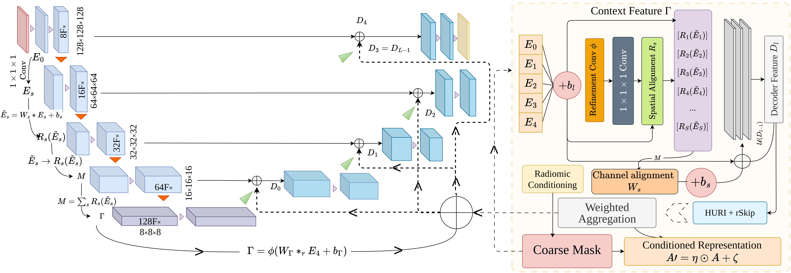

# ReFRM3D: A Radiomics-enhanced Fused Residual Multiparametric 3D Network with Multi-Scale Feature Fusion for Glioma Characterization

This repository contains the ReFRM3D implementation for 3D glioma segmentation. The network combines multi-scale feature fusion, hybrid upsampling and residual integration, and radiomic conditioning from a coarse tumor prediction. Model over view is given below:




## Repository layout

```text
├── src/refrm3d/
│   ├── data/             # case discovery, NIfTI loading, and datasets
│   ├── evaluation/       # segmentation and classification metrics
│   ├── models/           # ReFRM3D network and reusable 3D blocks
│   ├── preprocessing/    # brain masking, PCA crop, normalization, resizing
│   ├── radiomics/        # first-order, GLCM, and GLRLM descriptors
│   └── training/         # objectives and epoch routines
├── scripts/
│   ├── train.py
│   └── evaluate.py
├── fig/
│   └── refrm3d_overview.png
├── data/raw/             # optional location for MRI data
└── pyproject.toml
```

## Dataset

The loader accepts BraTS2019, BraTS2020, BraTS2021, and similarly organized BraTS releases. No release-specific directory name is required. Point `--data-root` to a directory containing the cases directly or to a parent containing nested dataset directories. Case directories are found recursively from their FLAIR files.

Each labeled case must contain co-registered NIfTI files for FLAIR, T1ce (also accepts the `_t1gd` suffix), T2, and a segmentation mask. The T1 sequence is optional. Files may use `.nii` or `.nii.gz` suffixes. Segmentation labels are expected to be `0`, `1`, `2`, and `4`.

For example, this structure is supported without renaming its folders:

```text
/datasets/any-release-name/
├── training-folder/
│   └── any-case-name/
│       ├── any-case-name_flair.nii.gz
│       ├── any-case-name_t1.nii.gz
│       ├── any-case-name_t1ce.nii.gz
│       ├── any-case-name_t2.nii.gz
│       └── any-case-name_seg.nii.gz
└── validation-folder/
    └── another-case-name/
        └── ...
```

Training recursively discovers all labeled cases below the selected root, combines them, shuffles them with the configured seed, and creates a 75/25 train/validation split. Unlabeled cases are excluded from supervised training.

## Training configuration

The default training setup:

| Setting | Default |
| --- | ---: |
| Optimizer | Adam |
| Learning rate | `0.0001` |
| Batch size | `2` |
| Epochs | `100` |
| Training/validation split | `75% / 25%` |
| Random seed | `42` |
| Input volume | `128 × 128 × 128` |
| Input channels | FLAIR, T1ce, T2 |
| Focal-loss gamma | `2` |

The objective combines class-weighted Dice and focal losses with the coarse-region supervision used by the model. Runtime options are available through the training script.

## Useage

Install the package and its declared dependencies from this directory:

```bash
cd /path/to/code
python -m pip install -e .
```

The project requires Python 3.10 or newer, PyTorch, NumPy, nibabel, and SciPy. A CUDA-enabled PyTorch installation is recommended for training.

Set the root to the directory containing the dataset folders you want to combine:

```bash
python scripts/train.py \
    --data-root /path/to/your/dataset-root \
    --output-dir outputs
```

To override manuscript defaults:

```bash
python scripts/train.py \
    --data-root /path/to/your/dataset-root \
    --epochs 100 \
    --batch-size 2 \
    --learning-rate 1e-4 \
    --validation-fraction 0.25 \
    --seed 42
```

Preprocessed cases are cached under a sibling `processed/refrm3d` directory. The cache is reusable across training and evaluation runs with the same input size and preprocessing options.

## Citations
The manuscript is currently under review. Our preprint is availabe on [arXiv](https://doi.org/10.48550/arXiv.2512.22570).

```bash
@article{rahman2025refrm3d,
    title={ReFRM3D: A Radiomics-enhanced Fused Residual Multiparametric 3D Network with Multi-Scale Feature Fusion for Glioma Characterization},
    author={Rahman, Md Abdur and Raiaan, Mohaimenul Azam Khan and Abian, Arefin Ittesafun and Zhang, Yan and Jonkman, Mirjam and Azam, Sami},
    journal={arXiv preprint arXiv:2512.22570},
    year={2025}
}
